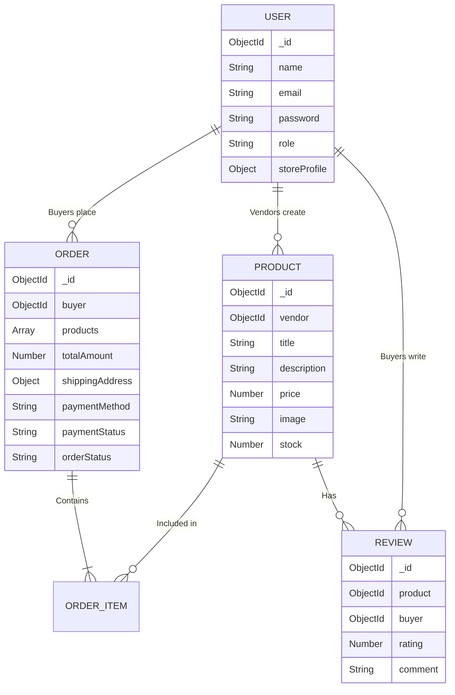

# Artisan's Corner - E-commerce Platform for Handmade Goods

## Live Application
Live link: https://artisans-corner-pneh.onrender.com (hosted on Render's free plan, so the first load can take about a minute). Payments use Stripe test mode: use card 4242 4242 4242 4242 with any future date and CVC.

## Demo Credentials
- **Demo Vendor**:
  - Email: luna@demo.com
  - Password: password123
- **Demo Buyer**:
  - Email: alice@demo.com
  - Password: password123

## Structure
The project is divided into:
- **Frontend**: React, Redux Toolkit, Tailwind CSS
- **Backend**: Node.js, Express, MongoDB

### Backend Setup
1. `cd backend`
2. `npm install`
3. Add your variables to `.env` (MONGO_URI, JWT_SECRET, Stripe & Cloudinary keys).
4. Run `node seed.js` to seed demo users.
5. `npm run dev`

### Frontend Setup
1. `cd frontend`
2. `npm install`
3. `npm run dev`

## Database Schema Diagram

